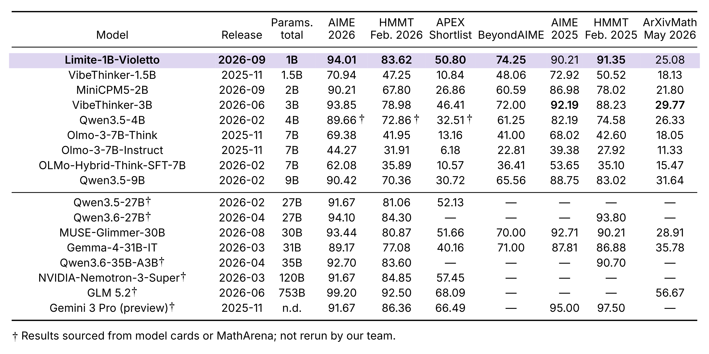

# Limite 1B - Violetto

Paradigma's first model, built for high-throughput mathematical reasoning.

[GitHub & vLLM plugin](https://github.com/paradigma-inc/limite-violetto) · [Release blog](https://paradigma.inc/blog/limite-1b-violetto/)

## Overview

Limite 1B - Violetto is Paradigma’s first model, designed for high-throughput solutions of difficult mathematical problems.

Limite is a 1-billion parameter dense autoregressive transformer, trained from scratch on a mixture of less than 300B highly curated tokens, capable of handling sequences up to 131k tokens long.

Apart from data curation, we achieve such high sample efficiency by equipping Limite with an architecture strongly inspired by recent advancements made by the community on pre-training speedrun competitions. The base model itself scores well on math benchmarks with few-shot prompting.

We leverage a mix of synthetic data generation, curated SFT and RL post-training to achieve results on competition-level math that rivals recent models tens of times larger, trained with orders of magnitudes more FLOPs. As an example, Limite achieves an average of 74.25% on BeyondAIME, with MUSE-Glimmer-30B scoring 70%. The full table with evaluations is available below.

## Evaluation

Results across seven mathematical benchmarks, including AIME 2026, HMMT February 2026, APEX Shortlist, and BeyondAIME. Scores are percentages; higher is better.



† Marked results are taken from model cards or MathArena and were not reevaluated by our team. A dash indicates an unreported result; “n.d.” indicates an undisclosed parameter count. Evaluation configurations may differ across models and sources.

See the [release blog](https://paradigma.inc/blog/limite-1b-violetto/) for the model overview and examples, and the [GitHub repository](https://github.com/paradigma-inc/limite-violetto) for serving code and usage details.

## Run with vLLM

This repository contains the Violetto checkpoint and tokenizer. To run the model, use the [Limite vLLM plugin on GitHub](https://github.com/paradigma-inc/limite-violetto).

**Python 3.12 · vLLM 0.26.0 · PyTorch 2.11.0 (CUDA 13.0) · Transformers 5.6.2**

On Linux x86-64 with an NVIDIA GPU and a CUDA 13.0-compatible NVIDIA driver, install [uv](https://docs.astral.sh/uv/getting-started/installation/), then follow the GitHub quickstart:

```bash
git clone https://github.com/paradigma-inc/limite-violetto.git
cd limite-violetto
uv sync --locked
```

This installs the plugin and its locked serving dependencies, including vLLM, CUDA-enabled PyTorch, and Transformers. The NVIDIA driver must already be installed on the host; a separate CUDA toolkit installation is not required.

From the same directory, start Violetto:

```bash
VLLM_PLUGINS=limite uv run --locked vllm serve paradigma-inc/limite-1b-violetto
```

**Sampling settings:** We recommend `temperature=0.6` and `top_p=0.95`. These defaults are included in [`generation_config.json`](https://huggingface.co/paradigma-inc/limite-1b-violetto/blob/main/generation_config.json) and are loaded automatically by the vLLM command above. Explicit request parameters override these defaults, so set both values explicitly if your client supplies its own sampling settings.

The checkpoint is downloaded from Hugging Face on first use. Keep tensor and pipeline parallel sizes at 1. For full setup instructions and the option to install only the plugin into an existing compatible environment, see the [GitHub README](https://github.com/paradigma-inc/limite-violetto#quickstart).

**Hugging Face Transformers compatibility is coming soon.** We will release support for loading and running Violetto directly with Transformers.

## Prompting and intended use

Limite is designed to be as lightly instruction-tuned as possible, to challenge the assumption that models need to be embedded in an assistant persona to function well. As a result, Limite is designed to be used to respond in single turns, with an extremely high mathematical capability per parameter count.

Limite is designed to be a strong reasoner of mathematical problems. As a result, its response patterns are radically different than that of regular assistants, and shouldn’t be used expecting instruction following in the same form as other, more general-purpose language models.

Limite can lose the scope of a prompt and reinterpret it as a different—often mathematical—task.

See the [release blog](https://paradigma.inc/blog/limite-1b-violetto/) for examples.

## License

The model weights are released under **Apache-2.0**. The [vLLM serving code](https://github.com/paradigma-inc/limite-violetto/blob/main/LICENSE) is also licensed under Apache-2.0.

## Citation

```bibtex
@misc{paradigma2026limite,
  title = {{Limite 1B - Violetto}},
  author = {Prignano, Mario and Cirillo, Gabriele and
            Morosini, Alessio and Cerovaz, Luca and
            Bartolocci, Alessandro and Rodolà, Emanuele and
            Starace, Giulio and Pappone, Francesco},
  year = {2026},
  howpublished = {\url{https://paradigma.inc/blog/limite-1b-violetto/}}
}
```
